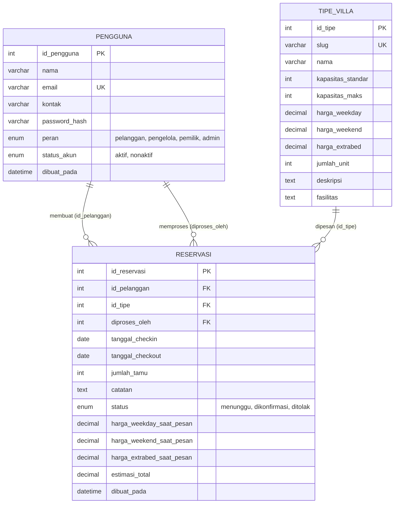

# Struktur Basis Data — Villa Joglo Masayu

Basis data dirancang menggunakan **MySQL / MariaDB** dengan engine **InnoDB** dan set karakter **`utf8mb4_unicode_ci`**. Relasi antar tabel dijaga menggunakan *Foreign Key Constraints* untuk menjamin integritas referensial.

---

## 1. Diagram Konseptual (ERD)



---

## 2. Kamus Data & Rincian Tabel

### Tabel 1: `pengguna`
Menyimpan seluruh data identitas dan akun sistem (Pelanggan, Pengelola, Pemilik, Admin).

| Nama Kolom | Tipe Data | Nullable | Keterangan |
|---|---|---|---|
| `id_pengguna` | `INT` | No | Primary Key, Auto Increment |
| `nama` | `VARCHAR(100)` | No | Nama lengkap pengguna |
| `email` | `VARCHAR(100)` | No | Alamat email unik (digunakan untuk login) |
| `kontak` | `VARCHAR(30)` | No | Nomor telepon / WhatsApp aktif |
| `password_hash` | `VARCHAR(255)` | No | Hash kata sandi (`PASSWORD_DEFAULT` / Bcrypt) |
| `peran` | `ENUM` | No | `'pelanggan'`, `'pengelola'`, `'pemilik'`, `'admin'` |
| `status_akun` | `ENUM` | No | `'aktif'`, `'nonaktif'` (akun nonaktif ditolak saat login) |
| `dibuat_pada` | `DATETIME` | No | Waktu pembuatan akun (default: `CURRENT_TIMESTAMP`) |

---

### Tabel 2: `tipe_villa`
Menyimpan master data tipe villa arsitektur Joglo. Nilai diselaraskan dengan data asli pada `script.js`.

| Nama Kolom | Tipe Data | Nullable | Keterangan |
|---|---|---|---|
| `id_tipe` | `INT` | No | Primary Key, Auto Increment |
| `slug` | `VARCHAR(100)` | No | Slug unik untuk URL (contoh: `joglo-wulung`) |
| `nama` | `VARCHAR(100)` | No | Nama villa (Joglo Wulung, Joglo Saren, Joglo Agung) |
| `kapasitas_standar` | `INT` | No | Jumlah tamu standar tanpa extra bed |
| `kapasitas_maks` | `INT` | No | Batas maksimal tamu dengan extra bed |
| `harga_weekday` | `DECIMAL(12,2)` | No | Tarif per malam hari Senin s.d. Kamis |
| `harga_weekend` | `DECIMAL(12,2)` | No | Tarif per malam hari Jumat s.d. Minggu |
| `harga_extrabed` | `DECIMAL(12,2)` | No | Tarif extra bed per orang per malam |
| `jumlah_unit` | `INT` | No | Ketersediaan unit fisik (placeholder TODO: 1) |
| `deskripsi` | `TEXT` | Yes | Narasi profil dan filosofi kayu bangunan |
| `fasilitas` | `TEXT` | Yes | Daftar fasilitas dalam format JSON Array string |

---

### Tabel 3: `reservasi`
Menyimpan transaksi permohonan reservasi villa oleh tamu.

| Nama Kolom | Tipe Data | Nullable | Keterangan |
|---|---|---|---|
| `id_reservasi` | `INT` | No | Primary Key, Auto Increment |
| `id_pelanggan` | `INT` | No | FK ke `pengguna.id_pengguna` (pembuat reservasi) |
| `id_tipe` | `INT` | No | FK ke `tipe_villa.id_tipe` |
| `diproses_oleh` | `INT` | Yes | FK ke `pengguna.id_pengguna` (staf yang mengonfirmasi/menolak) |
| `tanggal_checkin` | `DATE` | No | Tanggal mulai menginap (check-in) |
| `tanggal_checkout` | `DATE` | No | Tanggal keluar (check-out) |
| `jumlah_tamu` | `INT` | No | Jumlah orang yang menginap |
| `catatan` | `TEXT` | Yes | Catatan atau permintaan khusus dari tamu |
| `status` | `ENUM` | No | `'menunggu'`, `'dikonfirmasi'`, `'ditolak'` |
| `harga_weekday_saat_pesan` | `DECIMAL(12,2)` | No | Snapshot tarif weekday saat transaksi dibuat |
| `harga_weekend_saat_pesan` | `DECIMAL(12,2)` | No | Snapshot tarif weekend saat transaksi dibuat |
| `harga_extrabed_saat_pesan` | `DECIMAL(12,2)` | No | Snapshot tarif extra bed saat transaksi dibuat |
| `estimasi_total` | `DECIMAL(12,2)` | No | Total nilai estimasi sewa selama masa menginap |
| `dibuat_pada` | `DATETIME` | No | Waktu pengajuan reservasi |

---

## 3. Indeks dan Integritas Relasional

### Indeks Komposit Ketersediaan (`idx_ketersediaan`)
Untuk mempercepat pengecekan jadwal reservasi yang tumpang tindih secara real-time, dibuat indeks komposit:
```sql
INDEX `idx_ketersediaan` (`id_tipe`, `tanggal_checkin`, `tanggal_checkout`, `status`);
```

### Relasi Kunci Asing (Foreign Keys)
1. `fk_reservasi_pelanggan`:
   `FOREIGN KEY (id_pelanggan) REFERENCES pengguna(id_pengguna) ON DELETE RESTRICT ON UPDATE CASCADE`
   *(Mencegah penghapusan akun pelanggan yang memiliki riwayat reservasi).*
2. `fk_reservasi_tipe`:
   `FOREIGN KEY (id_tipe) REFERENCES tipe_villa(id_tipe) ON DELETE RESTRICT ON UPDATE CASCADE`
   *(Mencegah penghapusan master tipe villa yang sedang digunakan pada data reservasi).*
3. `fk_reservasi_pengelola`:
   `FOREIGN KEY (diproses_oleh) REFERENCES pengguna(id_pengguna) ON DELETE SET NULL ON UPDATE CASCADE`
   *(Jika akun staf dihapus/dinonaktifkan, riwayat reservasi tetap aman dengan kolom penanda menjadi NULL).*

---

## 4. Logika Perhitungan Tarif & Pemeriksaan Jadwal

### 1. Snapshot Tarif
Kolom `harga_weekday_saat_pesan`, `harga_weekend_saat_pesan`, dan `harga_extrabed_saat_pesan` disimpan saat reservasi dibuat. Hal ini menjamin bahwa jika pengelola menaikkan tarif villa di masa depan, nilai tagihan pada riwayat reservasi lama tidak berubah (akurat secara historis).

### 2. Rumus Estimasi Nilai Reservasi
$$\text{Estimasi Total} = (\text{malam\_weekday} \times \text{tarif\_weekday}) + (\text{malam\_weekend} \times \text{tarif\_weekend}) + (\text{extra\_bed} \times \text{tarif\_extrabed} \times \text{total\_malam})$$
- Jika $\text{jumlah\_tamu} > \text{kapasitas\_standar}$, maka $\text{extra\_bed} = \text{jumlah\_tamu} - \text{kapasitas\_standar}$.

### 3. Rumus Tumpang Tindih Tanggal (Overlapping)
Dua rentang tanggal $A = [in_A, out_A)$ dan $B = [in_B, out_B)$ saling bertabrakan jika dan hanya jika:
$$in_A < out_B \quad \text{AND} \quad out_A > in_B$$
Query MySQL yang diimplementasikan:
```sql
SELECT COUNT(*) FROM `reservasi`
WHERE `id_tipe` = :id_tipe
  AND `status` = 'dikonfirmasi'
  AND `tanggal_checkin` < :checkout_baru
  AND `tanggal_checkout` > :checkin_baru;
```
Jika jumlah reservasi terkonfirmasi yang bentrok $\ge \text{jumlah\_unit}$, maka sistem menyatakan unit **tidak tersedia** (penuh).
