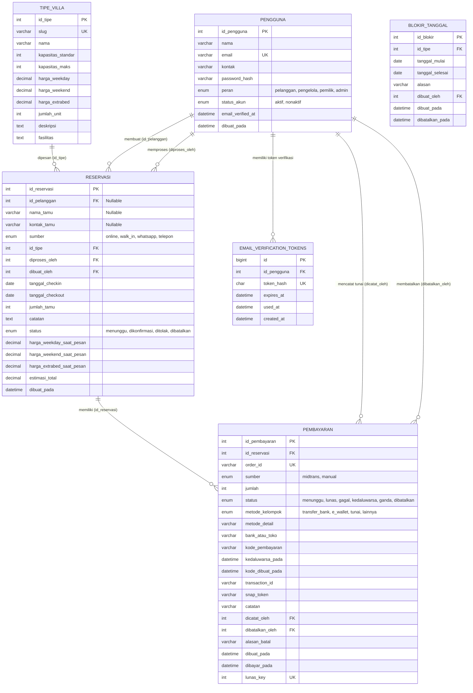

# Struktur Basis Data — Villa Joglo Masayu

Basis data dirancang menggunakan **MySQL / MariaDB** dengan engine **InnoDB** dan set karakter **`utf8mb4_unicode_ci`**. Relasi antar tabel dijaga menggunakan *Foreign Key Constraints* untuk menjamin integritas referensial.

---

## 1. Diagram Konseptual (ERD)



---

## 2. Kamus Data & Rincian Tabel

### Tabel 1: `pengguna`
Menyimpan seluruh data identitas dan akun sistem (Pelanggan, Pengelola, Pemilik, Admin).

| Nama Kolom | Tipe Data | Nullable | Keterangan |
|---|---|---|---|
| `id_pengguna` | `INT` | No | Primary Key, Auto Increment |
| `nama` | `VARCHAR(100)` | No | Nama lengkap pengguna |
| `email` | `VARCHAR(100)` | No | Alamat email unik (digunakan untuk login) |
| `kontak` | `VARCHAR(30)` | No | Nomor telepon / WhatsApp aktif |
| `password_hash` | `VARCHAR(255)` | No | Hash kata sandi (`PASSWORD_DEFAULT` / Bcrypt) |
| `peran` | `ENUM` | No | `'pelanggan'`, `'pengelola'`, `'pemilik'`, `'admin'` |
| `status_akun` | `ENUM` | No | `'aktif'`, `'nonaktif'` (akun nonaktif ditolak saat login) |
| `email_verified_at` | `DATETIME` | Yes | Waktu verifikasi email; `NULL` jika belum diverifikasi |
| `dibuat_pada` | `DATETIME` | No | Waktu pembuatan akun (default: `CURRENT_TIMESTAMP`) |

---

### Tabel 2: `tipe_villa`
Menyimpan master data tipe villa arsitektur Joglo. Nilai diselaraskan dengan data asli pada `script.js`.

| Nama Kolom | Tipe Data | Nullable | Keterangan |
|---|---|---|---|
| `id_tipe` | `INT` | No | Primary Key, Auto Increment |
| `slug` | `VARCHAR(100)` | No | Slug unik untuk URL (contoh: `joglo-wulung`) |
| `nama` | `VARCHAR(100)` | No | Nama villa (Joglo Wulung, Joglo Saren, Joglo Agung) |
| `kapasitas_standar` | `INT` | No | Jumlah tamu standar tanpa extra bed |
| `kapasitas_maks` | `INT` | No | Batas maksimal tamu dengan extra bed |
| `harga_weekday` | `DECIMAL(12,2)` | No | Tarif per malam hari Senin s.d. Kamis |
| `harga_weekend` | `DECIMAL(12,2)` | No | Tarif per malam hari Jumat s.d. Minggu |
| `harga_extrabed` | `DECIMAL(12,2)` | No | Tarif extra bed per orang per malam |
| `jumlah_unit` | `INT` | No | Ketersediaan unit fisik (placeholder TODO: 1) |
| `deskripsi` | `TEXT` | Yes | Narasi profil dan filosofi kayu bangunan |
| `fasilitas` | `TEXT` | Yes | Daftar fasilitas dalam format JSON Array string |

---

### Tabel 3: `reservasi`
Menyimpan transaksi permohonan reservasi villa baik secara online oleh pelanggan terdaftar maupun offline (walk-in, WhatsApp, telepon) yang dicatat staf Pengelola.

| Nama Kolom | Tipe Data | Nullable | Keterangan |
|---|---|---|---|
| `id_reservasi` | `INT` | No | Primary Key, Auto Increment |
| `id_pelanggan` | `INT` | Yes | FK ke `pengguna.id_pengguna` (pembuat reservasi online, NULL jika tamu offline) |
| `nama_tamu` | `VARCHAR(100)` | Yes | Nama tamu (wajib diisi bila `id_pelanggan` NULL) |
| `kontak_tamu` | `VARCHAR(20)` | Yes | Nomor telepon / WhatsApp tamu |
| `sumber` | `ENUM` | No | `'online'`, `'walk_in'`, `'whatsapp'`, `'telepon'` (default: `'online'`) |
| `id_tipe` | `INT` | No | FK ke `tipe_villa.id_tipe` |
| `diproses_oleh` | `INT` | Yes | FK ke `pengguna.id_pengguna` (staf yang mengonfirmasi/menolak) |
| `dibuat_oleh` | `INT` | Yes | FK ke `pengguna.id_pengguna` (staf yang mencatat reservasi offline) |
| `tanggal_checkin` | `DATE` | No | Tanggal mulai menginap (check-in) |
| `tanggal_checkout` | `DATE` | No | Tanggal keluar (check-out) |
| `jumlah_tamu` | `INT` | No | Jumlah orang yang menginap |
| `catatan` | `TEXT` | Yes | Catatan atau permintaan khusus dari tamu |
| `status` | `ENUM` | No | `'menunggu'`, `'dikonfirmasi'`, `'ditolak'`, `'dibatalkan'` |
| `harga_weekday_saat_pesan` | `DECIMAL(12,2)` | No | Snapshot tarif weekday saat transaksi dibuat |
| `harga_weekend_saat_pesan` | `DECIMAL(12,2)` | No | Snapshot tarif weekend saat transaksi dibuat |
| `harga_extrabed_saat_pesan` | `DECIMAL(12,2)` | No | Snapshot tarif extra bed saat transaksi dibuat |
| `estimasi_total` | `DECIMAL(12,2)` | No | Total nilai estimasi sewa selama masa menginap |
| `dibuat_pada` | `DATETIME` | No | Waktu pengajuan reservasi |

---

### Tabel 4: `blokir_tanggal`
Menyimpan periode tanggal di mana unit villa diblokir dari pemesanan (untuk pemeliharaan rutin, perbaikan fasilitas, atau penggunaan pribadi oleh Pemilik).

| Nama Kolom | Tipe Data | Nullable | Keterangan |
|---|---|---|---|
| `id_blokir` | `INT` | No | Primary Key, Auto Increment |
| `id_tipe` | `INT` | No | FK ke `tipe_villa.id_tipe` |
| `tanggal_mulai` | `DATE` | No | Tanggal awal pemblokiran (inklusif) |
| `tanggal_selesai` | `DATE` | No | Tanggal akhir pemblokiran (eksklusif, seperti tanggal check-out) |
| `alasan` | `VARCHAR(200)` | No | Keterangan alasan pemblokiran (perawatan, pemilik, dll.) |
| `dibuat_oleh` | `INT` | Yes | FK ke `pengguna.id_pengguna` (staf yang membuat blokir) |
| `dibuat_pada` | `DATETIME` | No | Waktu pembuatan blokir (default: `CURRENT_TIMESTAMP`) |
| `dibatalkan_pada` | `DATETIME` | Yes | Waktu pembatalan blokir (soft-cancel; jika diisi, blokir tidak aktif) |

---

### Tabel 5: `pembayaran`
Menyimpan riwayat percobaan transaksi pembayaran online (Midtrans Snap) dan pencatatan kas tunai oleh Pengelola.

| Nama Kolom | Tipe Data | Nullable | Keterangan |
|---|---|---|---|
| `id_pembayaran` | `INT` | No | Primary Key, Auto Increment |
| `id_reservasi` | `INT` | No | FK ke `reservasi.id_reservasi` (ON DELETE RESTRICT ON UPDATE RESTRICT) |
| `order_id` | `VARCHAR(50)` | No | Pengidentifikasi unik transaksi (`MSY-...` atau `TUNAI-...`), UNIQUE |
| `sumber` | `ENUM` | No | `'midtrans'`, `'manual'` (default: `'midtrans'`) |
| `jumlah` | `INT` | No | Nominal pembayaran penuh (Rupiah integer, dihitung dari database server) |
| `status` | `ENUM` | No | `'menunggu'`, `'lunas'`, `'gagal'`, `'kedaluwarsa'`, `'ganda'`, `'dibatalkan'` |
| `metode_kelompok` | `ENUM` | Yes | Kelompok metode: `'transfer_bank'`, `'e_wallet'`, `'tunai'`, `'lainnya'` |
| `metode_detail` | `VARCHAR(30)` | Yes | Rincian `payment_type` Midtrans (misal: `bca_va`, `gopay`, `qris`) atau `'cash'` |
| `bank_atau_toko` | `VARCHAR(30)` | Yes | Nama bank penerbit VA (bca, bni, bri, mandiri, permata, cimb) atau nama minimarket (indomaret, alfamart) |
| `kode_pembayaran` | `VARCHAR(64)` | Yes | Nomor Virtual Account atau kode pembayaran minimarket yang diterbitkan Midtrans |
| `kedaluwarsa_pada` | `DATETIME` | Yes | Waktu batas kedaluwarsa pembayaran resmi dari Midtrans (`expiry_time`) dalam zona waktu WIB |
| `kode_dibuat_pada` | `DATETIME` | Yes | Waktu pencatatan/penerbitan nomor kode pembayaran (WIB) |
| `transaction_id` | `VARCHAR(64)` | Yes | ID transaksi unik dari sistem Midtrans |
| `snap_token` | `VARCHAR(100)` | Yes | Token sesi pembayaran Midtrans Snap |
| `catatan` | `VARCHAR(200)` | Yes | Catatan tambahan transaksi |
| `dicatat_oleh` | `INT` | Yes | FK ke `pengguna.id_pengguna` (Pengelola yang mencatat tunai manual) |
| `dibatalkan_oleh` | `INT` | Yes | FK ke `pengguna.id_pengguna` (Admin yang membatalkan catatan tunai) |
| `alasan_batal` | `VARCHAR(200)` | Yes | Alasan pembatalan catatan tunai |
| `dibuat_pada` | `DATETIME` | No | Waktu pembuatan order pembayaran (WIB) |
| `dibayar_pada` | `DATETIME` | Yes | Waktu aktual penyelesaian pembayaran / settlement (WIB) |
| `lunas_key` | `INT` (Generated) | Yes | Stored Generated: `IF(status='lunas', id_reservasi, NULL)`, UNIQUE INDEX |

---

### Tabel 6: `email_verification_tokens`
Menyimpan hash token verifikasi email pelanggan. Token asli hanya dikirim melalui tautan email; token yang tersimpan memiliki masa berlaku dan dapat ditandai sudah digunakan.

| Nama Kolom | Tipe Data | Nullable | Keterangan |
|---|---|---|---|
| `id` | `BIGINT UNSIGNED` | No | Primary Key, Auto Increment |
| `id_pengguna` | `INT` | No | FK ke `pengguna.id_pengguna`; token dihapus bersama akun |
| `token_hash` | `CHAR(64)` | No | Hash SHA-256 token, UNIQUE |
| `expires_at` | `DATETIME` | No | Batas waktu berlakunya token |
| `used_at` | `DATETIME` | Yes | Waktu token digunakan atau dibatalkan |
| `created_at` | `DATETIME` | No | Waktu token dibuat |

Kolom `pengguna.email_verified_at` menyimpan waktu verifikasi. Nilai `NULL` berarti email pelanggan belum terverifikasi.

---

## 3. Indeks dan Integritas Relasional

### Indeks Komposit Ketersediaan (`idx_ketersediaan`)
Untuk mempercepat pengecekan jadwal reservasi yang tumpang tindih secara real-time, dibuat indeks komposit:
```sql
INDEX `idx_ketersediaan` (`id_tipe`, `tanggal_checkin`, `tanggal_checkout`, `status`);
```

### Relasi Kunci Asing (Foreign Keys)
1. `fk_reservasi_pelanggan`:
   `FOREIGN KEY (id_pelanggan) REFERENCES pengguna(id_pengguna) ON DELETE RESTRICT ON UPDATE CASCADE`
   *(Mencegah penghapusan akun pelanggan yang memiliki riwayat reservasi).*
2. `fk_reservasi_tipe`:
   `FOREIGN KEY (id_tipe) REFERENCES tipe_villa(id_tipe) ON DELETE RESTRICT ON UPDATE CASCADE`
   *(Mencegah penghapusan master tipe villa yang sedang digunakan pada data reservasi).*
3. `fk_reservasi_pengelola`:
   `FOREIGN KEY (diproses_oleh) REFERENCES pengguna(id_pengguna) ON DELETE SET NULL ON UPDATE CASCADE`
   *(Jika akun staf dihapus/dinonaktifkan, riwayat reservasi tetap aman dengan kolom penanda menjadi NULL).*
4. `fk_pembayaran_reservasi`:
   `FOREIGN KEY (id_reservasi) REFERENCES reservasi(id_reservasi) ON DELETE RESTRICT ON UPDATE RESTRICT`
   *(Integritas reservasi yang memiliki transaksi pembayaran; ON UPDATE RESTRICT wajib karena id_reservasi menjadi sumber kolom stored generated lunas_key).*
5. `fk_pembayaran_dicatat` & `fk_pembayaran_dibatalkan`:
   `FOREIGN KEY (dicatat_oleh/dibatalkan_oleh) REFERENCES pengguna(id_pengguna) ON DELETE SET NULL ON UPDATE CASCADE`

### Aturan Satu-Lunas (One-Paid-Per-Reservation)
Satu reservasi diperbolehkan memiliki beberapa riwayat percobaan pembayaran (misal token kedaluwarsa atau gagal lalu mencoba kembali), namun **tepat maksimal 1 pembayaran berstatus `lunas`**. Aturan ini ditegakkan pada dua lapis keamanan:
1. **Integritas Basis Data:** Kolom Stored Generated `lunas_key INT GENERATED ALWAYS AS (IF(status='lunas', id_reservasi, NULL)) STORED` dengan `UNIQUE INDEX uq_pembayaran_reservasi_lunas (lunas_key)`. Di MySQL, indeks unik mengizinkan nilai `NULL` berulang kali, tetapi menolak duplikasi bilangan integer `id_reservasi` ketika status bernilai `lunas`.
2. **Integritas Aplikasi (Pessimistic Locking):** Penguncian transaksi baris reservasi melalui klausa `SELECT id_reservasi FROM reservasi WHERE id_reservasi = ? FOR UPDATE` sebelum memproses notifikasi webhook atau mencatat tunai manual.

### Pemisahan Status Pembayaran dan Reservasi
Status pembayaran (`menunggu`, `lunas`, `gagal`, `kedaluwarsa`, `ganda`, `dibatalkan`) dipisahkan secara struktural dari status permohonan reservasi (`menunggu`, `dikonfirmasi`, `ditolak`). Hal ini menjaga agar algoritma ketersediaan kamar tidak terganggu sekaligus memungkinkan pelacakan audit transaksi finansial secara independen.

---

## 4. Logika Perhitungan Tarif & Pemeriksaan Jadwal

### 1. Snapshot Tarif
Kolom `harga_weekday_saat_pesan`, `harga_weekend_saat_pesan`, dan `harga_extrabed_saat_pesan` disimpan saat reservasi dibuat. Hal ini menjamin bahwa jika pengelola menaikkan tarif villa di masa depan, nilai tagihan pada riwayat reservasi lama tidak berubah (akurat secara historis).

### 2. Rumus Estimasi Nilai Reservasi
$$\text{Estimasi Total} = (\text{malam\_weekday} \times \text{tarif\_weekday}) + (\text{malam\_weekend} \times \text{tarif\_weekend}) + (\text{extra\_bed} \times \text{tarif\_extrabed} \times \text{total\_malam})$$
- Jika $\text{jumlah\_tamu} > \text{kapasitas\_standar}$, maka $\text{extra\_bed} = \text{jumlah\_tamu} - \text{kapasitas\_standar}$.

### 3. Rumus Tumpang Tindih Tanggal (Overlapping)
Dua rentang tanggal $A = [in_A, out_A)$ dan $B = [in_B, out_B)$ saling bertabrakan jika dan hanya jika:
$$in_A < out_B \quad \text{AND} \quad out_A > in_B$$
Query MySQL yang diimplementasikan:
```sql
SELECT COUNT(*) FROM `reservasi`
WHERE `id_tipe` = :id_tipe
  AND `status` = 'dikonfirmasi'
  AND `tanggal_checkin` < :checkout_baru
  AND `tanggal_checkout` > :checkin_baru;
```
Jika jumlah reservasi terkonfirmasi yang bentrok $\ge \text{jumlah\_unit}$, maka sistem menyatakan unit **tidak tersedia** (penuh).

